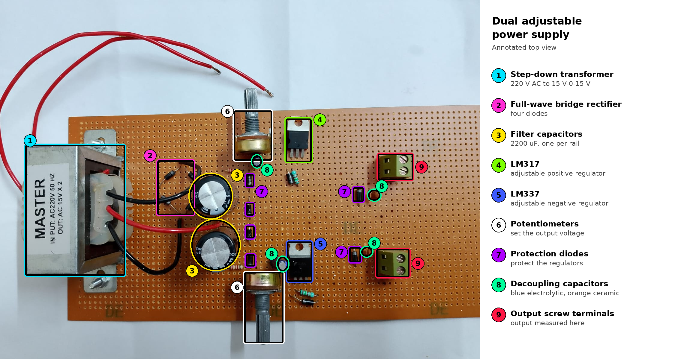
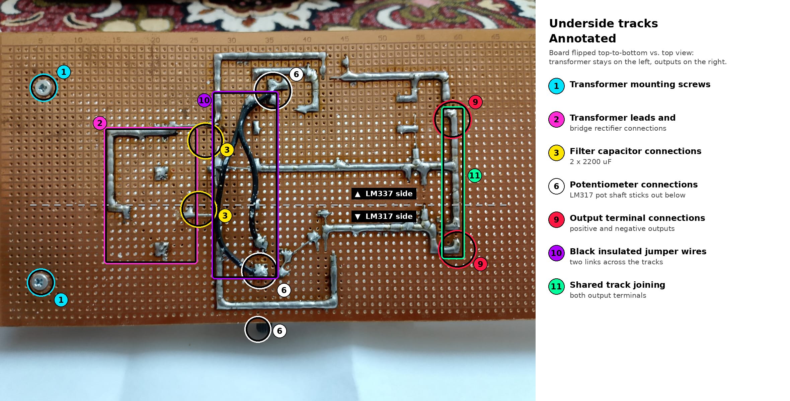

# Dual Adjustable DC Power Supply (LM317 / LM337)

**Electronic Devices Lab · Institute of Space Technology, Islamabad**

A hand-built, regulated DC power supply that converts 220 V AC mains into adjustable DC output voltages. A center-tapped step-down transformer feeds a full-wave bridge rectifier and large filter capacitors, and an **LM317** (positive) and an **LM337** (negative) adjustable regulator, each with its own potentiometer, set the output voltage. The circuit was soldered on Veroboard and tested with a multimeter, which read about **5.0 V** at the output terminals.

---

## Hardware



*Top view with the main parts labelled.*



*Underside of the Veroboard showing the track layout and solder joints.*

---

## Result

| Parameter | Value |
|---|---|
| Input | 220 V AC, 50 Hz |
| Transformer secondary | 15 V - 0 - 15 V AC (center-tapped) |
| Measured output | about 5.0 V DC (multimeter across the output screw terminals) |
| Output adjustment | Potentiometers on each regulator |

---

## How it works

```
220 V AC  →  Step-down  →  Full-wave bridge  →  Filter caps   →  LM317 / LM337  →  Regulated DC
 mains        transformer     rectifier           (2200 µF)       adjustable          output
```

**1. Step-down transformer.** The transformer reduces the 220 V mains to a center-tapped 15 V - 0 - 15 V secondary. The center tap serves as the common ground, which makes both a positive and a negative supply rail possible. A 15 V RMS winding has a peak of about `15 × √2 ≈ 21 V`.

**2. Full-wave bridge rectification.** Four diodes in a bridge conduct on both half-cycles of the AC input, so both halves of the waveform produce output. The ripple frequency is therefore 100 Hz, twice the mains frequency, which is easier to filter than the 50 Hz ripple of a half-wave design. The unregulated DC level is roughly the peak voltage minus two diode drops (about 1.4 V), so about 20 V per rail before loading.

**3. Capacitor filtering.** A 2200 µF electrolytic capacitor on each rail smooths the pulsating DC. For full-wave rectification the ripple is approximately `ΔV ≈ I_load / (2 · f · C)`. As an illustration, at a 100 mA load the ripple is about 0.45 V peak to peak.

**4. Adjustable regulation.** Each regulator holds its output steady as the input and load change:

- **LM317** is an adjustable *positive* regulator with output `V_out = 1.25 V × (1 + R2 / R1)`, where the potentiometer forms the adjustable resistor R2.
- **LM337** is the *negative* counterpart, with output `V_out = −1.25 V × (1 + R2 / R1)`.

Turning the potentiometer changes the resistor ratio and therefore the output voltage.

**5. Protection and decoupling.** Diodes around the regulators protect them from reverse voltage and from the large capacitors discharging backwards when the supply is switched off. Small electrolytic and ceramic capacitors close to the regulators improve stability and suppress noise.

---

## Circuit concepts demonstrated

| Concept | Where it appears |
|---|---|
| Transformer step-down and center tap | 220 V to 15 V - 0 - 15 V, giving a common ground for dual rails |
| Full-wave bridge rectification | Four-diode bridge converting AC to pulsating DC on both half-cycles |
| Ripple and capacitor filtering | 2200 µF filter capacitors, with ripple set by load current and capacitance |
| Linear voltage regulation | LM317 and LM337 hold a stable output against input and load changes |
| Adjustable voltage divider | Potentiometer and resistors set the regulator output voltage |
| Dual-polarity supply design | Positive (LM317) and negative (LM337) regulation from one center-tapped transformer |
| Protection of semiconductor devices | Diodes guard the regulators against reverse voltage and capacitor discharge |
| Decoupling | Small capacitors near the regulators for stability and noise rejection |

---

## Components

| Component | Details |
|---|---|
| Transformer | 220 V AC, 50 Hz in; 15 V - 0 - 15 V AC out |
| Bridge rectifier | Four rectifier diodes |
| Filter capacitors | 2 × 2200 µF electrolytic |
| Positive regulator | LM317 (adjustable) |
| Negative regulator | LM337 (adjustable) |
| Potentiometers | 5 kΩ and 10 kΩ, one per regulator |
| Protection diodes | Across and around the regulators |
| Decoupling capacitors | Small electrolytic and ceramic capacitors |
| Resistors | In the voltage-setting network of each regulator |
| Output | Screw terminals |
| Board | Veroboard (stripboard), hand-soldered |

---

## Build and testing

The circuit was soldered by hand on Veroboard, with the tracks cut and linked on the underside as shown in the photo. For testing, the transformer primary was connected to the mains through a switch, and the multimeter probes were placed on the output screw terminals. The meter read about 5.0 V.

---

## Design notes and limitations

- **Heat in the regulators.** A linear regulator dissipates `(V_in − V_out) × I` as heat. With about 20 V in and 5 V out, a 200 mA load would dissipate roughly 3 W in each regulator, so heatsinks are needed for anything beyond light loads.
- **Ripple.** The output is only as clean as the filter allows, and larger capacitors or a lower load current reduce ripple.
- **No input fuse or enclosure.** This prototype has exposed mains connections.
- **Mains safety.** Mains voltage is dangerous. Never touch the primary side or the transformer connections while the circuit is powered.

### Possible improvements

- Add heatsinks to both regulators and a fuse on the transformer primary.
- Add an LED power indicator and a voltmeter display on each output.
- Add output capacitors for better transient response.
- Mount the circuit in an insulated enclosure.

---

## Repository contents

```
dual-adjustable-power-supply/
├── README.md
└── images/
    ├── annotated_top_view.png
    └── annotated_underside_tracks.png
```
